# Laboratorio Modelo C4 · Gestor de Turnos Laborales

**Caso:** Grano Dorado · 3 sucursales · 45 empleados · operación de 06:00 a 22:00
**Proyecto:** Gestor de Turnos Laborales ITM (Kotlin Multiplatform + Compose Multiplatform)
**Fuentes:** historias de usuario HU-01 a HU-17 (épicas 1 a 5), documento de patrones del equipo y estructura del código del repositorio

> Cada nivel C4 amplía el nivel anterior: contexto → contenedores → componentes → código.

---

## 1. Comprensión del problema

### 1.1 Situación actual

Hoy los horarios se publican en un grupo de WhatsApp y se arman a mano en Excel. Ese Excel no sabe nada de descansos ni vacaciones, así que se programan turnos a personas no disponibles. Tampoco hay control de acceso ni registro de asistencia. Programar la semana le toma unas 8 horas al Administrador General (HU-07).

El sistema debe programar turnos sin conflictos, publicarlos a cada empleado y registrar cambios de turno, novedades y asistencia.

### 1.2 Actores principales

| Actor | Responsabilidad | Historias |
|---|---|---|
| Administrador General | Registra empleados, define el catálogo de turnos y programa las 3 sucursales | HU-03, HU-04, HU-06, HU-07, HU-08 |
| Administrador de Sucursal | Programa su sucursal, aprueba cambios, revisa novedades, completa marcas y atiende incumplimientos | HU-07, HU-08, HU-12, HU-13, HU-14, HU-16, HU-17 |
| Empleado operativo (cajero, barista, cocinero) | Consulta su horario, pide cambios de turno, reporta novedades y marca asistencia | HU-09, HU-10, HU-11, HU-15 |

### 1.3 Sistemas externos

| Sistema | Para qué se usa | Historias | Estado |
|---|---|---|---|
| Google | Inicio de sesión con cuenta de Google | HU-01 | Definido |
| Servicio de correo electrónico | Correos de activación y de recuperación de clave | HU-02, HU-03 | Proveedor por contratar |
| Servicio de notificaciones | Avisos de horario publicado, cambios de turno e incumplimientos | HU-07, HU-09, HU-10, HU-13, HU-17 | Canal por definir (push, correo o SMS) |

### 1.4 Alcance por épica

| Épica | Historias |
|---|---|
| 1. Gestión de usuarios y acceso | HU-01 Login · HU-02 Recuperación de clave · HU-03 Creación de empleados · HU-04 Actualización de empleados |
| 2. Planificación y asignación de turnos | HU-06 Creación de turnos · HU-07 Asignación de turnos · HU-08 Horarios por sucursal |
| 3. Portal de empleado | HU-09 Ver horario asignado · HU-10 Solicitar cambio de turno · HU-11 Reportar novedades |
| 4. Gestión de novedades | HU-12 Ver novedades · HU-13 Aprobar cambios de turno · HU-14 Reportar novedades de empleado |
| 5. Control de asistencia | HU-15 Marcar asistencia · HU-16 Marcar asistencia (supervisor) · HU-17 Notificaciones de incumplimientos |

### 1.5 Estado actual del proyecto

El proyecto todavía no cumple todas las historias de usuario. Por eso los diagramas distinguen lo que ya existe de lo planeado:

- **Existe en el código:** el frontend. Hay tres módulos Gradle (`shared`, `webApp`, `androidApp`). El módulo `shared` tiene 9 pantallas, 8 ViewModels y los componentes de UI, con arquitectura MVVM.
- **Planeado:** el backend. Aún no hay API, base de datos ni conexión a servicios externos, y el proyecto no incluye librerías de red ni de persistencia. Los niveles 2 a 4 proponen cómo construirlo en Kotlin.

La relación entre cada pantalla y su historia se dedujo del nombre del archivo. Hay que confirmar en el código qué criterios de aceptación cubre cada pantalla.

### 1.6 Convenciones de los diagramas

Se usa la notación C4 de la guía, y cada diagrama trae su propia leyenda.

| Símbolo | Significado |
|---|---|
| Figura azul oscuro | Persona |
| Caja azul | Sistema en alcance (nivel 1) o contenedor (nivel 2) |
| Cilindro azul | Contenedor de base de datos |
| Caja azul claro | Componente (nivel 3) |
| Caja gris | Sistema externo |
| Rectángulo punteado sin relleno | Límite del sistema o del contenedor (el zoom) |
| Flecha punteada con texto | Relación; entre corchetes, la tecnología o el protocolo |
| Borde punteado en una caja | Elemento que aún no existe o está por definir |
| Etiqueta verde «EN EL CÓDIGO» | El archivo existe en el repositorio (no implica que la HU esté completa) |
| Etiqueta naranja «PLANEADO» | Diseño propuesto, sin código todavía |
| Etiqueta morada «SIN HISTORIA» | El sistema lo necesita, pero ninguna HU lo construye |
| Nivel 4: cabecera verde, naranja o azul | Clase que participa en un patrón GoF de comportamiento, estructural o creacional |
| Nivel 4: etiqueta «Patrón · rol» | Patrón GoF y rol de la clase (nombres de rol del libro GoF) |
| Nivel 4: etiqueta «nueva» o «propuesta» | Clase agregada en la revisión de patrones; «propuesta» depende de una decisión pendiente |
| Nivel 4: marco punteado con el nombre del patrón | Agrupa los participantes cuando un diagrama tiene más de un patrón o el patrón ocupa una zona propia |

---

## 2. C4 Nivel 1 - Contexto

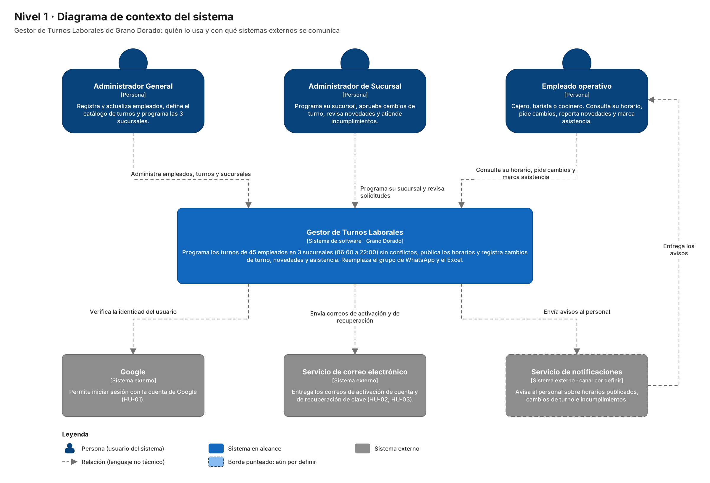

El sistema es la única puerta de entrada para los tres perfiles; lo que cambia es el alcance. El Administrador General ve las tres sucursales, el Administrador de Sucursal solo la suya y el empleado solo sus turnos. WhatsApp y Excel no aparecen como sistemas externos porque el sistema los reemplaza; no se integra con ellos.

**Audiencia:** dirección de Grano Dorado y personas no técnicas. Por eso las relaciones usan lenguaje sencillo.

---

## 3. C4 Nivel 2 - Contenedores


| Contenedor | Tecnología | Responsabilidad | Estado |
|---|---|---|---|
| Aplicación web | Kotlin/Wasm (y JS) + Compose Multiplatform | Interfaz responsiva en computador y navegador móvil (RNF-04) | Existe |
| Aplicación Android | Kotlin + Compose Multiplatform, Android 7.0+ | La misma interfaz como app instalada | Existe; ver decisión D1 |
| API REST de turnos | Kotlin + Ktor sobre JVM | Autenticación, permisos, reglas de negocio, hora oficial del servidor y tareas en segundo plano | Planeado |
| Base de datos | PostgreSQL | Empleados, catálogo de turnos, semanas y asignaciones, solicitudes, novedades, marcas e historial | Planeado |

### 3.1 Decisiones tecnológicas

| Decisión | Motivo |
|---|---|
| Ktor para la API | Es de JetBrains, está escrito en Kotlin y permite compartir modelos con el módulo `shared` usando `kotlinx.serialization` |
| Las reglas viven en la API, no en el cliente | HU-15 exige la hora del servidor, CA-01.6 exige revalidar permisos aunque se entre por URL directa y HU-17 evalúa turnos sin que nadie tenga la app abierta |
| PostgreSQL | Datos relacionales (empleado, turno, semana, asignación) con transacciones para los intercambios de HU-13 |
| JSON sobre HTTPS con token JWT | Un solo protocolo para web y Android, sin estado en el servidor |

### 3.2 Seguridad

- Todo el tráfico va por HTTPS/TLS; en producción solo queda expuesto el puerto 443.
- La sesión usa JWT y se cierra tras 30 minutos de inactividad (HU-01).
- La cuenta se bloquea 15 minutos después de 5 intentos fallidos (HU-01).
- Las contraseñas se guardan con bcrypt (RNF-06).
- La API aplica la matriz de permisos por rol y sucursal en cada petición (CA-01.6).

**Audiencia:** desarrolladores, arquitectos, seguridad e infraestructura.

---

## 4. C4 Nivel 3 - Componentes

### 4.1 API REST de turnos (planeada)

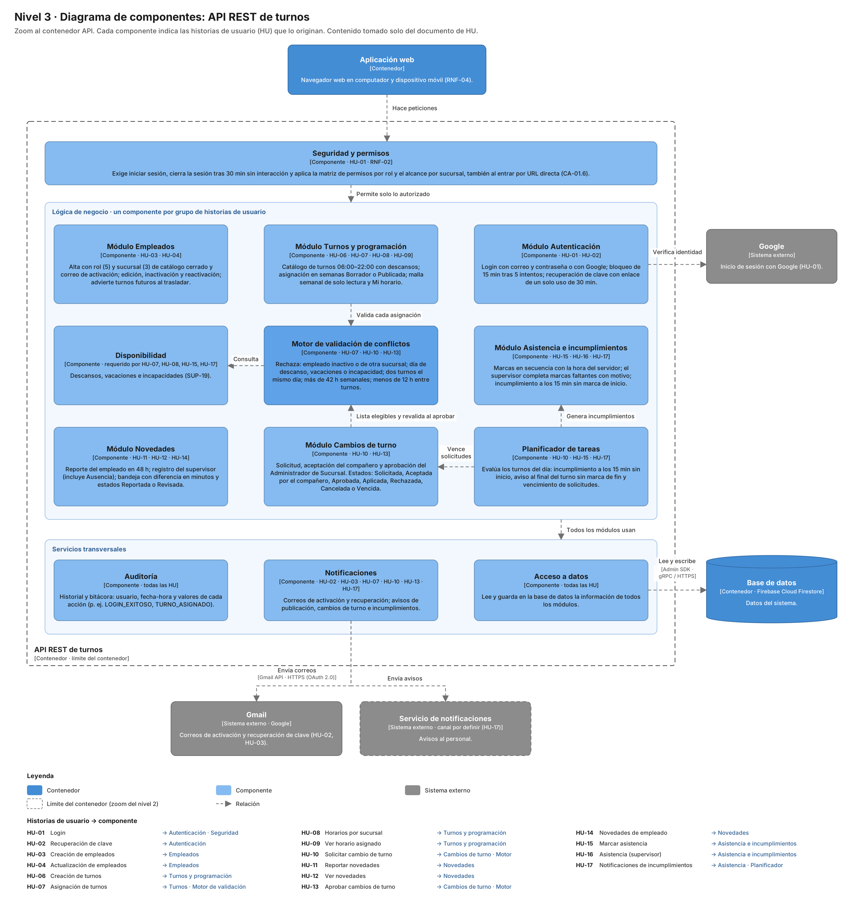

Cada componente agrupa las historias de usuario que lo originan, y su descripción se tomó únicamente del documento de HU. El diagrama no fija tecnologías porque el documento no las define. Los patrones GoF se ven dentro de cada componente, en el nivel 4.

| Componente | Historias | Qué hace según las HU |
|---|---|---|
| Seguridad y permisos | HU-01, RNF-02 | Exige iniciar sesión, cierra la sesión tras 30 min sin interacción y aplica la matriz de permisos por rol y sucursal, también al entrar por URL directa (CA-01.6) |
| Módulo Autenticación | HU-01, HU-02 | Login con correo y contraseña o con Google; bloqueo de 15 min tras 5 intentos; recuperación de clave con enlace de un solo uso de 30 min |
| Módulo Empleados | HU-03, HU-04 | Alta con rol (5) y sucursal (3) de catálogo cerrado y correo de activación; edición, inactivación y reactivación; advierte turnos futuros al trasladar |
| Módulo Turnos y programación | HU-06, HU-07, HU-08, HU-09 | Catálogo de turnos 06:00–22:00 con descansos; asignación en semanas Borrador o Publicada; malla semanal de solo lectura y Mi horario |
| Motor de validación de conflictos | HU-07, HU-10, HU-13 | Rechaza empleado inactivo o de otra sucursal, día de descanso, vacaciones o incapacidad, dos turnos el mismo día, más de 42 h semanales y menos de 12 h entre turnos |
| Disponibilidad | Requerido por HU-07, HU-08, HU-15, HU-17 | Descansos, vacaciones e incapacidades (SUP-19). El documento lo exige como dependencia, pero no tiene HU propia |
| Módulo Asistencia e incumplimientos | HU-15, HU-16, HU-17 | Marcas en secuencia con la hora del servidor; el supervisor completa marcas faltantes con motivo; incumplimiento a los 15 min sin marca de inicio |
| Módulo Novedades | HU-11, HU-12, HU-14 | Reporte del empleado en 48 h; registro del supervisor (incluye Ausencia); bandeja con diferencia en minutos y estados Reportada o Revisada |
| Módulo Cambios de turno | HU-10, HU-13 | Solicitud, aceptación del compañero y aprobación del Administrador de Sucursal; estados Solicitada, Aceptada por el compañero, Aprobada, Aplicada, Rechazada, Cancelada o Vencida |
| Planificador de tareas | HU-10, HU-15, HU-17 | Evalúa los turnos del día: incumplimiento a los 15 min sin inicio, aviso al final del turno sin marca de fin y vencimiento de solicitudes |
| Auditoría | Todas | Historial y bitácora con usuario, fecha-hora y valores de cada acción |
| Notificaciones | HU-02, HU-03, HU-07, HU-10, HU-13, HU-17 | Correos de activación y recuperación; avisos de publicación, cambios de turno e incumplimientos (canal por definir) |
| Acceso a datos | Todas | Lee y guarda en la base de datos la información de todos los módulos |

### 4.2 Aplicación web y Android (existente)

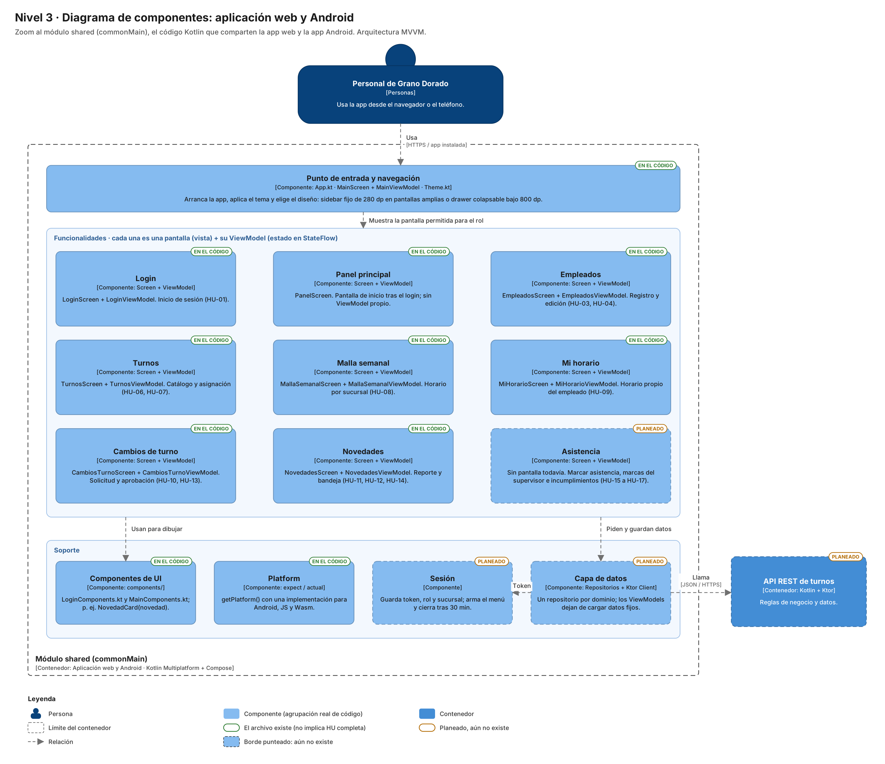

El módulo `shared` concentra toda la interfaz y los ViewModels, y lo comparten la app web y la app Android. Cada funcionalidad es una pantalla (vista) más su ViewModel. Faltan la funcionalidad de Asistencia (épica 5) y dos componentes de soporte: Sesión y Capa de datos. Esta última hará que los ViewModels dejen de cargar los datos por su cuenta y empiecen a consumir la API.

| Componente | Archivos | Estado |
|---|---|---|
| Punto de entrada y navegación | `App.kt`, `MainScreen.kt`, `MainViewModel.kt`, `Theme.kt` | Existe |
| Login | `LoginScreen.kt`, `LoginViewModel.kt` | Existe |
| Panel principal | `PanelScreen.kt` | Existe |
| Empleados | `EmpleadosScreen.kt`, `EmpleadosViewModel.kt` | Existe |
| Turnos | `TurnosScreen.kt`, `TurnosViewModel.kt` | Existe |
| Malla semanal | `MallaSemanalScreen.kt`, `MallaSemanalViewModel.kt` | Existe |
| Mi horario | `MiHorarioScreen.kt`, `MiHorarioViewModel.kt` | Existe |
| Cambios de turno | `CambiosTurnoScreen.kt`, `CambiosTurnoViewModel.kt` | Existe |
| Novedades | `NovedadesScreen.kt`, `NovedadesViewModel.kt` | Existe |
| Componentes de UI | `components/LoginComponents.kt`, `components/MainComponents.kt` | Existe |
| Platform | `Platform.kt` + implementaciones `android`, `js` y `wasmJs` | Existe |
| Asistencia | — | Planeado |
| Sesión | — | Planeado |
| Capa de datos | — | Planeado |

**Audiencia:** desarrolladores, líderes de proyecto, Scrum Master y arquitectos.

---

## 5. C4 Nivel 4 - Código

Hay un diagrama de clases UML por cada componente de la lógica de negocio del nivel 3 de la API, más uno del frontend existente. Las clases, atributos, operaciones, estados y mensajes salen de las historias de usuario. En esta versión se aplicaron los patrones GoF seleccionados por el equipo (Observer, State, Chain of Responsibility, Adapter y Factory Method) donde el diseño lo necesita.

### 5.1 Revisión general y criterios

**Estado de los diagramas antes de la revisión.** Los nueve diagramas de la API representaban bien lo que piden las HU, pero se hicieron antes de elegir los patrones y tenían cuatro problemas de diseño:

| Diagrama | Problema encontrado |
|---|---|
| Motor de validación | Las 7 reglas eran métodos privados de `MotorValidacion`: una clase que crece con cada regla nueva y que hay que modificar si cambian los límites de 42 h o 12 h, que HU-07 advierte que no están validados jurídicamente. |
| Cambios de turno | `EstadoSolicitud` era una enumeración de 8 valores. Las reglas de qué acción se permite en cada estado quedaban repartidas en condicionales de dos servicios (`SolicitudesCambio` y `AprobacionCambios`). Además, cada transición debía avisar a alguien distinto y quedar registrada, y ese código se repetía en cada acción. |
| Novedades | Una sola `Novedad` con el campo `origen`: el estado inicial, los tipos permitidos (Ausencia solo para el supervisor) y la etiqueta «Registrada por…» dependían de condicionales sobre ese campo en dos servicios distintos. |
| Notificaciones | No tenía nivel 4. Cinco componentes envían correos o avisos, pero el proveedor de correo no está contratado (Bloqueante 2 de HU-02) y el canal de avisos no está definido (HU-07, HU-17). |

**Criterios usados para decidir.**

1. El patrón debe resolver un problema que las HU hacen visible (reglas, estados, avisos o variantes escritas en los criterios de aceptación), no uno hipotético.
2. Debe coincidir con la estructura del patrón descrita por Refactoring.Guru y el libro GoF (roles, relaciones y quién llama a quién), no solo con el nombre.
3. Se aplica en el backend. El frontend se conserva como está porque ya existe; solo se documenta.
4. Si una enumeración, una llamada directa o una tabla resuelven el problema con menos clases, se prefieren.
5. Las clases nuevas se marcan con la etiqueta **nueva** y las que dependen de una decisión pendiente, con **propuesta**.

**Cómo leer los diagramas con patrones.** Siguiendo la imagen de referencia, cada participante tiene la cabecera del color de la categoría del patrón: verde para comportamiento, naranja para estructural y azul para creacional. Encima lleva una etiqueta con el patrón y el rol GoF (por ejemplo, «State · Context»). Cuando hay dos patrones en un diagrama, cada uno se encierra en un marco punteado con su nombre. Al pie, el recuadro «Dónde está el patrón en este diagrama» relaciona cada rol con su clase.

**Resultado.** Cuatro diagramas aplican un patrón propio y uno combina dos. Notificaciones recibe un diagrama nuevo. Cinco diagramas no necesitan patrón y lo explican en una nota.

### 5.2 Módulo Empleados (HU-03, HU-04) · sin patrón propio


**Diagnóstico.** `GestionEmpleados` registra, lista, actualiza y cambia el estado de `Empleado`. Cada cambio queda en `CambioEmpleado` y antes de un traslado consulta los turnos futuros (CA-04.3). La responsabilidad está bien repartida.

**Decisión.** No se aplica un patrón propio. Factory Method para crear empleados según el rol se descartó: el rol es un dato de un catálogo cerrado y no cambia el comportamiento del empleado. Observer al cambiar rol o estado tampoco hace falta, porque las reacciones son dos y fijas: cerrar sesiones y registrar en Auditoría. El único cambio es que el correo de activación ahora indica que sale por Notificaciones, que aplica Adapter (sección 5.11).

### 5.3 Módulo Turnos y programación (HU-06, HU-07, HU-08, HU-09) · sin patrón propio


**Diagnóstico.** Tres servicios: `CatalogoTurnos`, `ProgramacionSemanal` y `ConsultaHorarios`. La lógica que podía crecer, las reglas de conflicto, ya está fuera de este módulo, en el Motor de validación.

**Decisión.** No se aplica un patrón propio. `Semana` tiene solo dos estados (Borrador y Publicada) y una transición, así que State sería sobreingeniería y basta la enumeración `EstadoSemana`. Abstract Factory para turnos por sucursal se descartó porque el catálogo es único (HU-06). `ProgramacionSemanal` es cliente de dos patrones de otros componentes: valida con el Motor (Chain of Responsibility) y avisa la publicación por Notificaciones (Adapter).

### 5.4 Módulo Autenticación (HU-01, HU-02) · sin patrón propio

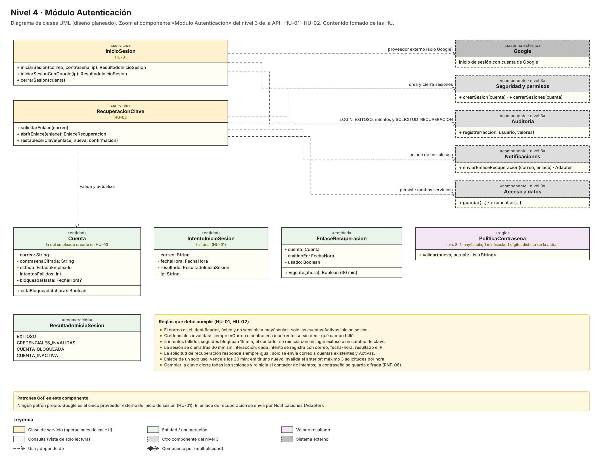

**Diagnóstico.** `InicioSesion` valida la `Cuenta`, aplica el bloqueo por intentos y registra cada `IntentoInicioSesion`. `RecuperacionClave` emite un `EnlaceRecuperacion` de un solo uso y valida la clave con `PoliticaContrasena`.

**Decisión.** No se aplica un patrón propio. Se evaluó Adapter para el inicio de sesión con Google: HU-01 solo admite Google y deja fuera Microsoft y redes sociales, así que no hay proveedores que intercambiar. Si en el futuro se agregan, ese sería el lugar: una interfaz de proveedor de identidad con un adaptador por proveedor. El enlace de recuperación sale por Notificaciones (Adapter).

### 5.5 Disponibilidad (sin HU propia, SUP-19) · sin patrón propio

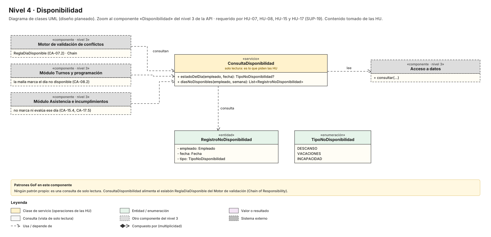

**Diagnóstico.** Solo se modela la consulta que piden HU-07, HU-08, HU-15 y HU-17: `estadoDelDia()` devuelve Descanso, Vacaciones o Incapacidad.

**Decisión.** No se aplica un patrón: es una consulta de solo lectura. `ConsultaDisponibilidad` es la fuente de datos del eslabón `ReglaDiaDisponible` del Motor.

### 5.6 Motor de validación de conflictos (HU-07, HU-10, HU-13) · Chain of Responsibility

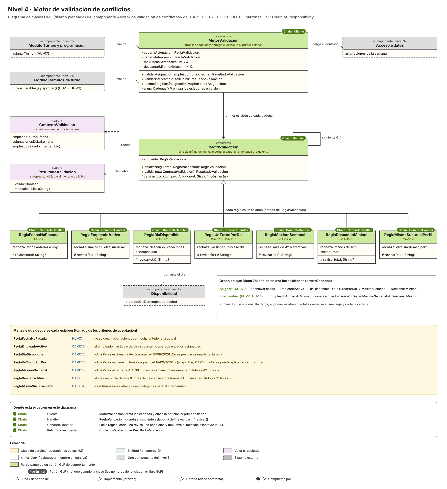

**Diagnóstico.** El motor reúne las reglas que comparten la asignación (HU-07) y el intercambio (HU-10, HU-13). En el diseño anterior cada regla era un método privado de `MotorValidacion`, lo que mezclaba en una clase el orden de las reglas, su lógica y sus mensajes.

1. **Patrón utilizado:** Chain of Responsibility (comportamiento).
2. **Problema que resuelve:** siete reglas independientes, cada una con su propio mensaje (CA-07.2 a CA-07.5, CA-10.4, CA-10.5, CA-13.5). Se aplican en orden, la primera que falla detiene la validación, y dos procesos usan combinaciones distintas: asignar usa seis reglas e intercambiar, cinco.
3. **Por qué se eligió:** Refactoring.Guru lo recomienda cuando varios manejadores deben ejecutarse en un orden específico y ese conjunto puede cambiar. Es exactamente el caso: HU-07 deja pendiente la revisión jurídica de los límites. Strategy no sirve porque elige un solo algoritmo, y aquí deben pasar todas las reglas.
4. **Dónde se observa:**
   - `ReglaValidacion` (Handler) tiene el atributo `siguiente: ReglaValidacion?` (autoasociación «siguiente 0..1»), `enlazar()`, `validar(ctx)` y el método abstracto `revisar(ctx)`.
   - Las 7 clases `Regla…` (ConcreteHandler) heredan de ella.
   - `MotorValidacion` (Client) arma `cadenaAsignacion` y `cadenaIntercambio` en `armarCadenas()`.
   - `ContextoValidacion` es la petición y `ResultadoValidacion`, la respuesta.
5. **Cómo funciona:** el motor carga el contexto (empleado, turno, fecha y asignaciones de la semana) y lo entrega al primer eslabón. Cada regla revisa su condición. Si falla, devuelve el mensaje exacto de la HU y corta la cadena; si pasa, entrega el contexto a la siguiente. El recuadro del diagrama muestra el orden de cada cadena: primero lo que no consulta datos.
6. **Beneficios y costos:** una regla nueva o un límite distinto se resuelve agregando o cambiando un eslabón (abierto/cerrado), y cada regla tiene una sola responsabilidad. Las mismas clases sirven a tres historias. El costo son 8 clases pequeñas en lugar de una, y que el orden de la cadena queda en `armarCadenas()` y hay que mantenerlo.

### 5.7 Módulo Asistencia e incumplimientos (HU-15, HU-16, HU-17) · sin patrón propio

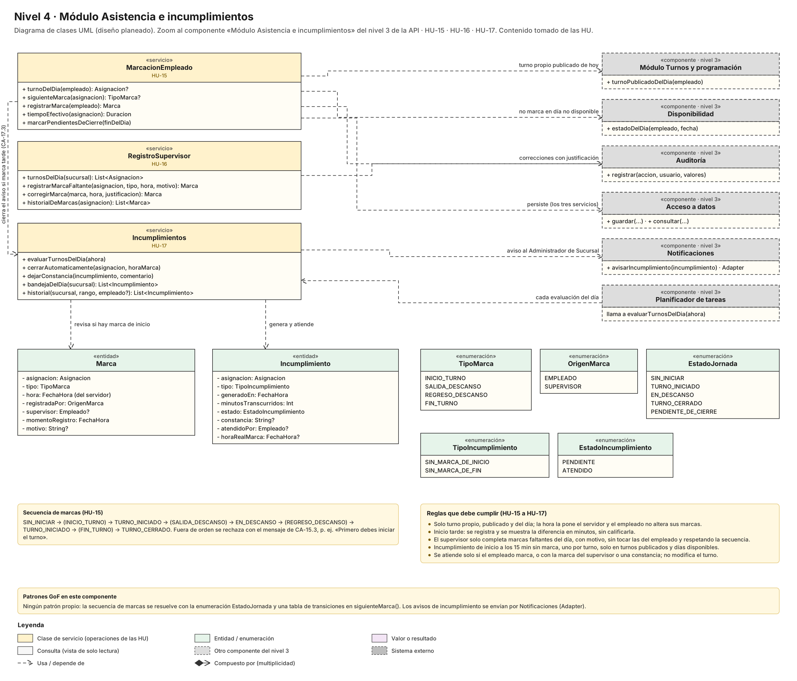

**Diagnóstico.** `MarcacionEmpleado` registra las marcas en secuencia con la hora del servidor, `RegistroSupervisor` completa las faltantes y `Incumplimientos` genera y atiende los avisos.

**Decisión.** No se aplica un patrón propio. La secuencia de marcas tiene 5 estados, pero cada estado solo responde a una pregunta: cuál es la siguiente marca permitida. Una tabla de transiciones en `siguienteMarca()` lo resuelve sin crear 5 clases, y State ya se usa en la solicitud de cambio. `Incumplimiento` tiene solo dos estados (Pendiente y Atendido). Los avisos de incumplimiento salen por Notificaciones (Adapter).

### 5.8 Módulo Novedades (HU-11, HU-12, HU-14) · Factory Method


**Diagnóstico.** La misma `Novedad` nace de dos maneras con reglas distintas:

- **La reporta el empleado (HU-11):** no admite Ausencia y nace Reportada.
- **La registra el supervisor (HU-14):** admite Ausencia sin hora real, nace Revisada y queda señalada «Registrada por…».

En el diseño anterior la diferencia dependía del campo `origen` y de condicionales en dos servicios. Un error, como crear una novedad del supervisor en estado Reportada, la mostraría como pendiente en la bandeja de HU-12.

1. **Patrón utilizado:** Factory Method (creacional).
2. **Problema que resuelve:** decidir qué variante de novedad se crea según quién la registra, sin repetir las validaciones comunes de plazo y horario (CA-11.3 y CA-14.5).
3. **Por qué se eligió:** en Factory Method el creador contiene lógica de negocio que trabaja con el producto mediante su interfaz, y las subclases solo deciden qué producto concreto crear. Aquí `registrar()` es esa lógica común. Abstract Factory se descartó porque solo hay un producto, no una familia; Builder, porque el problema no es el orden de construcción.
4. **Dónde se observa:**
   - `CreadorNovedad` (Creator) tiene `registrar()` y el factory method abstracto `crearNovedad()`.
   - `CreadorNovedadEmpleado` y `CreadorNovedadSupervisor` (ConcreteCreator) lo redefinen.
   - `Novedad` (Product, abstracta) declara `admiteTipo()` y `estadoInicial()`.
   - `NovedadDelEmpleado` y `NovedadDelSupervisor` (ConcreteProduct) implementan esas operaciones.
   - Las dependencias «crea» unen cada creador con su producto, y los servicios `ReporteNovedades` y `RegistroNovedadSupervisor` (Client) guardan cada uno su creador.
5. **Cómo funciona:** el servicio llama a `creador.registrar()`. Este valida el plazo y el horario una sola vez, llama a `crearNovedad()`, que la subclase resuelve con el producto correcto, pregunta al producto si admite el tipo y verifica que no exista otra novedad del mismo tipo para ese turno.
6. **Beneficios y costos:** cada novedad nace con el estado y el origen que exige su historia, y un nuevo origen solo agrega un creador y un producto. Desaparece la enumeración `OrigenNovedad`, porque la clase concreta ya dice quién la creó. El costo son 4 clases nuevas, y la persistencia debe guardar el tipo concreto de cada novedad.

La enumeración `EstadoNovedad` se mantiene: Reportada → Revisada son dos estados y no justifican State. La inconsistencia de HU-11 sobre la diferencia en minutos sigue señalada en el diagrama.

### 5.9 Módulo Cambios de turno (HU-10, HU-13) · State + Observer

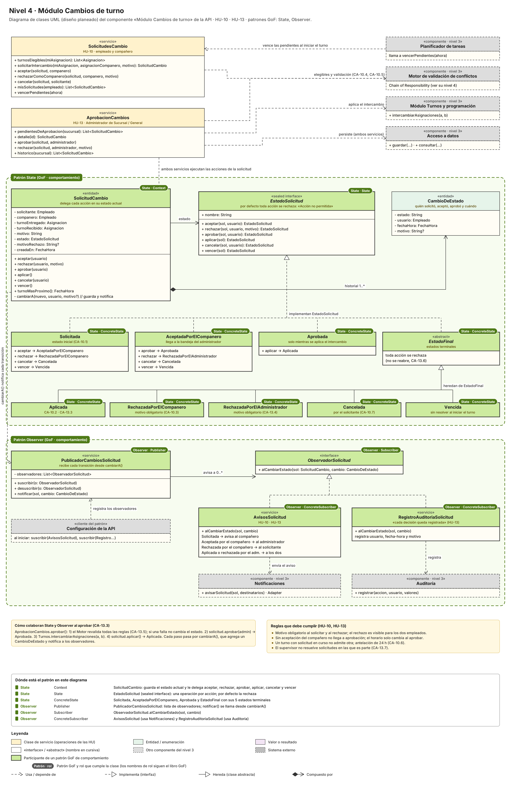

**Diagnóstico.** HU-10 define 8 estados y en cada uno la misma acción hace algo distinto. Por ejemplo, rechazar en Solicitada lleva a «Rechazada por el compañero», en Aceptada lleva a «Rechazada por el administrador», y en una solicitud resuelta no está permitido (CA-13.6). Además, cada transición tiene reacciones:

- avisar al compañero, al administrador, al solicitante o a ambos (CA-10.1, CA-10.2, CA-13.3);
- registrar la decisión con usuario y fecha-hora (HU-13).

En el diseño anterior todo eso quedaba en condicionales repetidos en `SolicitudesCambio` y `AprobacionCambios`.

**Patrón 1: State**

1. **Patrón utilizado:** State (comportamiento).
2. **Problema que resuelve:** 6 acciones × 8 estados. Si las reglas de qué se permite en cada estado quedan en condicionales, es fácil permitir una transición prohibida, como aprobar una solicitud vencida o sin la aceptación del compañero.
3. **Por qué se eligió:** Refactoring.Guru lo indica cuando el comportamiento depende del estado, hay muchos estados y abundan los condicionales sobre un campo. Con 8 estados se cumple la condición; con 2, como en Novedad o Semana, no. Se implementa con una sealed interface de Kotlin, cuyo compilador conoce todas las implementaciones.
4. **Dónde se observa:**
   - `SolicitudCambio` (Context) guarda `estado: EstadoSolicitud` y delega `aceptar`, `rechazar`, `aprobar`, `aplicar`, `cancelar` y `vencer`.
   - `EstadoSolicitud` (State) es una «sealed interface» que por defecto rechaza toda acción.
   - Son ConcreteState: `Solicitada`, `AceptadaPorElCompanero`, `Aprobada` y la clase abstracta `EstadoFinal`, de la que heredan `Aplicada`, `RechazadaPorElCompanero`, `RechazadaPorElAdministrador`, `Cancelada` y `Vencida`.
5. **Cómo funciona:** el contexto llama al estado actual. El estado devuelve el siguiente o rechaza la acción, y el contexto lo aplica con `cambiarA()`, que agrega un `CambioDeEstado` al historial. `EstadoFinal` agrupa los estados terminales, que no permiten ninguna acción (CA-13.6), para no repetir ese código cinco veces.
6. **Beneficios y costos:** las transiciones válidas quedan en un solo lugar por estado (responsabilidad única), y un estado nuevo, como el de «quién aprueba en ausencia del administrador» que HU-10 deja pendiente, se agrega sin tocar los demás. El costo son 9 clases pequeñas, y que la persistencia guarda `nombre` y reconstruye el objeto de estado al leer.

**Patrón 2: Observer**

1. **Patrón utilizado:** Observer (comportamiento), aplicado ahora en el backend.
2. **Problema que resuelve:** cada transición debe producir varias reacciones independientes (aviso a la persona que corresponde y registro de auditoría), y esas reacciones no deben vivir dentro de los estados ni repetirse en cada acción de los servicios.
3. **Por qué se eligió:** Refactoring.Guru lo indica cuando el cambio de un objeto debe provocar acciones en otros, y permite agregar suscriptores sin modificar al publicador. Aquí hay un único punto de cambio, `cambiarA()`, y al menos dos reacciones. HU-10 propone además, como mitigación, avisar de inmediato al administrador y mostrar el plazo de las pendientes: una reacción así se agrega como otro suscriptor.
4. **Dónde se observa:**
   - `PublicadorCambiosSolicitud` (Publisher) tiene `observadores`, `suscribir()`, `desuscribir()` y `notificar()`.
   - `ObservadorSolicitud` (Subscriber) declara `alCambiarEstado(sol, cambio)`.
   - Son ConcreteSubscriber: `AvisosSolicitud`, que elige destinatario según el estado y llama a Notificaciones, y `RegistroAuditoriaSolicitud`, que llama a Auditoría.
   - La «Configuración de la API» registra los observadores al iniciar.
   - La flecha «cambiarA() notifica cada transición» une el contexto con el publicador.
5. **Cómo funciona:** `cambiarA()` guarda el nuevo estado y el `CambioDeEstado` y llama a `notificar()`. Cada observador decide qué hacer con el cambio. El recuadro del diagrama muestra la secuencia completa de `aprobar()`: revalidación con el Motor, Aprobada, intercambio en Turnos y Aplicada.
6. **Beneficios y costos:** los estados no conocen Notificaciones ni Auditoría, y una nueva reacción, como un indicador de próximas a vencer, es otro observador. Los costos: el orden de notificación no está garantizado (aquí no importa) y hay que asegurar que un fallo al avisar no deshaga el cambio de estado.

**Cómo se complementan.** State decide si la transición es válida y cuál es el nuevo estado. Observer propaga el hecho a quien le interesa. Adapter, en Notificaciones, decide cómo se entrega el aviso. Ninguno hace el trabajo del otro.

### 5.10 Planificador de tareas (HU-10, HU-15, HU-17) · sin patrón propio

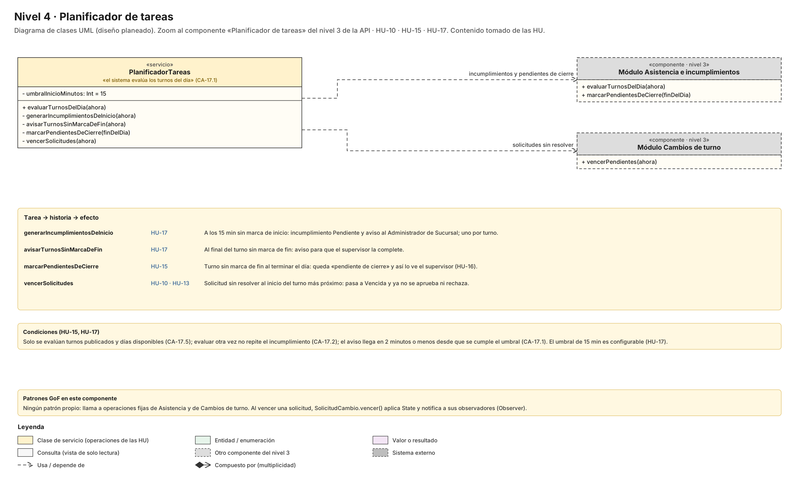

**Diagnóstico.** `PlanificadorTareas` evalúa los turnos del día y delega en Asistencia y en Cambios de turno.

**Decisión.** No se aplica un patrón. Se evaluó Observer, con el planificador publicando un «tic» y los módulos suscritos, y se descartó: llama a operaciones conocidas y fijas, y no hay suscriptores que cambien. Al vencer una solicitud, `SolicitudCambio.vencer()` pasa por State y notifica a sus observadores.

### 5.11 Notificaciones (HU-02, HU-03, HU-07, HU-10, HU-13, HU-17) · Adapter · diagrama nuevo


**Diagnóstico.** El componente existía en el nivel 3 pero no tenía nivel 4. Cinco componentes envían correos o avisos, pero no hay proveedor de correo contratado (Bloqueante 2 de HU-02) y HU-17 pide «definir el canal por el que se entrega la notificación». Si cada módulo llamara al proveedor, elegirlo o cambiarlo obligaría a modificar los cinco.

1. **Patrón utilizado:** Adapter (estructural), en su variante de objeto.
2. **Problema que resuelve:** la interfaz del servicio externo se conocerá solo cuando se elija el proveedor, y no coincide con lo que necesita el sistema: un mensaje con destinatario, asunto y contenido.
3. **Por qué se eligió:** Refactoring.Guru lo indica para usar una clase de terceros cuya interfaz no coincide con el resto del código. Como los clientes dependen solo de la interfaz, se pueden agregar o reemplazar adaptadores sin tocarlos. Facade se descartó porque no simplifica un subsistema propio; Bridge, porque solo varía una dimensión, el canal.
4. **Dónde se observa:**
   - `ServicioNotificaciones` (Client) redacta el `Mensaje` y usa `canalCorreo` y `canalAvisos`.
   - `CanalEnvio` (Target) declara `enviar(mensaje): ResultadoEnvio`.
   - `AdaptadorCorreo` (Adapter) envuelve a `ClienteProveedorCorreo` (Adaptee).
   - `AdaptadorAvisos` (Adapter, **propuesta**) envuelve a `ServicioDeAvisos` (Adaptee, canal por definir).
5. **Cómo funciona:** los módulos llaman a una operación de dominio, por ejemplo `avisarIncumplimiento()`. El servicio arma el texto de la HU (CA-17.1) y llama a `canal.enviar()`. El adaptador traduce el mensaje a la operación del proveedor y convierte su respuesta o error en `ResultadoEnvio`.
6. **Beneficios y costos:** las siete historias que avisan se pueden construir sin esperar la decisión D2. Mientras tanto, `canalAvisos` puede apuntar al mismo `AdaptadorCorreo`. En las pruebas se usa un adaptador falso que no envía correos reales. El costo es una interfaz y un adaptador por proveedor.

### 5.12 Aplicación: MVVM con Observer en Novedades (código existente, frontend)

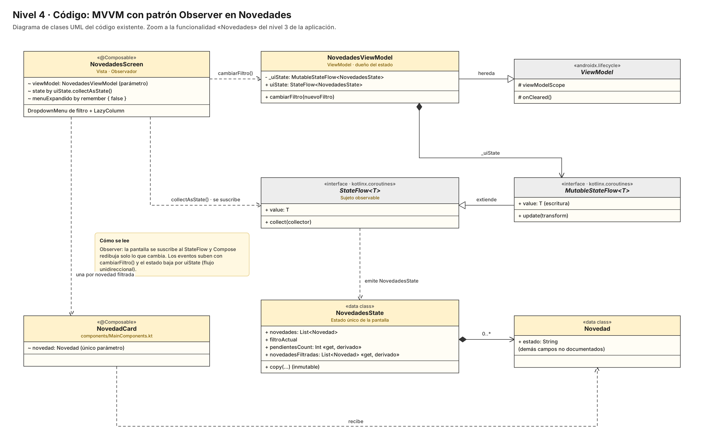

Este diagrama corresponde al frontend que ya existe, no a la API, y no se modificó. `NovedadesScreen` se suscribe al `StateFlow` del ViewModel con `collectAsState()`, y Compose redibuja cuando cambia el estado. Aquí el Observer lo aporta la librería (`StateFlow`) y ya está en el código. Por eso la aplicación de Observer que se diseña en esta revisión es la del backend (sección 5.9). Fragmento citado en el documento de patrones del equipo:

```kotlin
private val _uiState = MutableStateFlow(NovedadesState())
val uiState: StateFlow<NovedadesState> = _uiState.asStateFlow()

// Estado derivado dentro de NovedadesState
val pendientesCount: Int get() = novedades.count { it.estado == "REPORTADA" }
```

### 5.13 Tabla resumen de patrones en el nivel 4

| Diagrama del nivel 4 | Patrón aplicado | Problema que resuelve | Clases o interfaces involucradas | Ubicación visual en el diagrama |
|---|---|---|---|---|
| Motor de validación | Chain of Responsibility | 7 reglas en orden, cada una con su mensaje, compartidas por HU-07, HU-10 y HU-13 | `MotorValidacion` (Client), `ReglaValidacion` (Handler), 7 `Regla…` (ConcreteHandler), `ContextoValidacion`, `ResultadoValidacion` | Centro: Handler con autoasociación «siguiente 0..1»; fila de 7 eslabones verdes debajo; recuadro con el orden de cada cadena |
| Cambios de turno | State | 6 acciones × 8 estados sin condicionales repetidos | `SolicitudCambio` (Context), `EstadoSolicitud` (State), `Solicitada`, `AceptadaPorElCompanero`, `Aprobada`, `EstadoFinal` y sus 5 estados terminales (ConcreteState) | Marco punteado verde «Patrón State», mitad superior |
| Cambios de turno | Observer | Varias reacciones independientes a cada transición (avisos y auditoría) | `PublicadorCambiosSolicitud` (Publisher), `ObservadorSolicitud` (Subscriber), `AvisosSolicitud` y `RegistroAuditoriaSolicitud` (ConcreteSubscriber) | Marco punteado verde «Patrón Observer», mitad inferior |
| Novedades | Factory Method | La novedad nace con estado, tipos y origen distintos según quién la registra | `CreadorNovedad` (Creator), `CreadorNovedadEmpleado` y `CreadorNovedadSupervisor` (ConcreteCreator), `Novedad` (Product), `NovedadDelEmpleado` y `NovedadDelSupervisor` (ConcreteProduct) | Marco punteado azul «Patrón Factory Method»: creadores a la izquierda, productos a la derecha, unidos por «crea» |
| Notificaciones (nuevo) | Adapter | Proveedor de correo sin contratar y canal de avisos sin definir | `ServicioNotificaciones` (Client), `CanalEnvio` (Target), `AdaptadorCorreo` y `AdaptadorAvisos` (Adapter), `ClienteProveedorCorreo` y `ServicioDeAvisos` (Adaptee) | Marco punteado naranja «Patrón Adapter» bajo el servicio |
| Empleados | Ninguno | El rol no cambia el comportamiento; dos reacciones fijas | Usa Notificaciones (Adapter) | Nota «Patrones GoF en este componente» |
| Turnos y programación | Ninguno | `Semana` tiene 2 estados; catálogo único | Usa el Motor (Chain) y Notificaciones (Adapter) | Nota al pie |
| Autenticación | Ninguno | Solo Google como proveedor externo | Usa Notificaciones (Adapter) | Nota al pie |
| Disponibilidad | Ninguno | Consulta de solo lectura | Fuente de `ReglaDiaDisponible` | Nota al pie |
| Asistencia | Ninguno | La secuencia de marcas se resuelve con una tabla de transiciones | Usa Notificaciones (Adapter) | Nota al pie |
| Planificador | Ninguno | Llamadas fijas a dos operaciones conocidas | Dispara `vencer()` (State + Observer) | Nota al pie |
| MVVM (frontend) | Observer de la librería (`StateFlow`) | Redibujar la pantalla al cambiar el estado | `NovedadesViewModel`, `NovedadesScreen` | Código existente, sin cambios |

### 5.14 Referencias técnicas

- [Refactoring.Guru: Chain of Responsibility](https://refactoring.guru/design-patterns/chain-of-responsibility). Respalda la estructura Handler, BaseHandler, ConcreteHandler y Client, el corte de la cadena por un eslabón y su uso cuando los manejadores deben ejecutarse en un orden que puede cambiar.
- [Refactoring.Guru: State](https://refactoring.guru/design-patterns/state). Respalda los roles Context, State y ConcreteState, la clase intermedia para estados con código común (`EstadoFinal`), y la advertencia de que es excesivo con pocos estados, el criterio usado en Novedad, Semana e Incumplimiento.
- [Refactoring.Guru: Observer](https://refactoring.guru/design-patterns/observer). Respalda Publisher, Subscriber y ConcreteSubscriber, el paso de datos del evento como argumentos (`sol`, `cambio`), el cliente que registra suscriptores y el costo de que el orden de notificación no esté garantizado.
- [Refactoring.Guru: Adapter](https://refactoring.guru/design-patterns/adapter). Respalda la variante de objeto (Client, Client Interface, Service, Adapter) para servicios de terceros con interfaz incompatible.
- [Refactoring.Guru: Factory Method](https://refactoring.guru/design-patterns/factory-method). Respalda que el creador contenga la lógica de negocio que usa el producto (`registrar()`) y que las subclases decidan el producto concreto.
- [Kotlin: Sealed classes and interfaces](https://kotlinlang.org/docs/sealed-classes.html). Respalda implementar `EstadoSolicitud` como sealed interface: el compilador conoce todas las implementaciones y verifica que un `when` cubra todos los casos. La documentación aclara que en código común multiplataforma con `expect` sigue haciendo falta un `else`.

---

## 6. Diagramas complementarios

La guía pide el diagrama de despliegue en todo sistema que va a producción, además de los diagramas de clases y de secuencia de las funciones clave.

### 6.1 Diagrama de despliegue (propuesta)


Para 45 usuarios basta una máquina virtual Linux con Docker Compose y tres contenedores: Nginx (TLS, archivos de la app web y proxy hacia la API), la API en Ktor y PostgreSQL con volumen persistente. El reinicio automático y la copia de seguridad diaria apoyan el 99 % de disponibilidad (RNF-03).

### 6.2 Diagrama de secuencia: asignar un turno (HU-07)

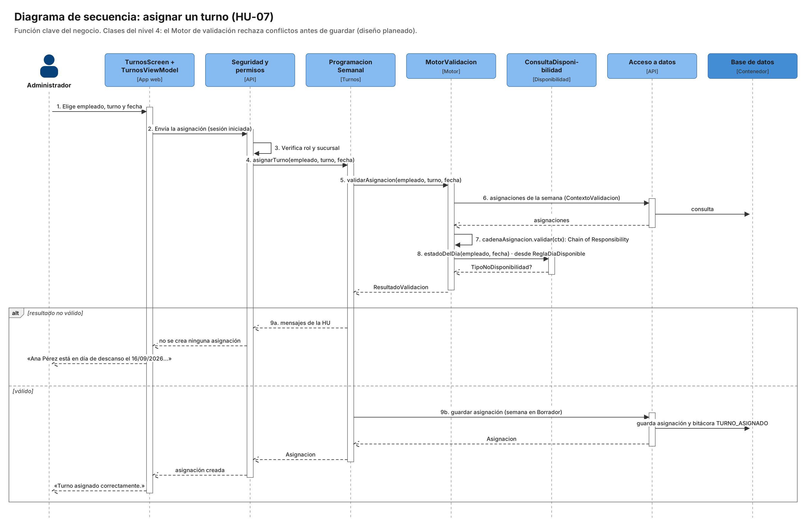

Asignar un turno es la función central del negocio. `ProgramacionSemanal` pide al `MotorValidacion` que valide; el motor carga las asignaciones de la semana en el `ContextoValidacion` y recorre la cadena de reglas (Chain of Responsibility), donde `ReglaDiaDisponible` consulta la disponibilidad. Solo si el resultado es válido se guarda la asignación en Borrador y la bitácora TURNO_ASIGNADO; si no, se devuelve el mensaje de la HU y no se crea nada.

---

## 7. Trazabilidad: historias de usuario → modelo

| HU | Pantalla (frontend) | Componente de la API | Estado |
|---|---|---|---|
| HU-01 Login | Login | Autenticación + Seguridad | Pantalla existe, API planeada |
| HU-02 Recuperación de clave | No identificada | Autenticación + Notificaciones | Planeado |
| HU-03 Creación de empleados | Empleados | Empleados | Pantalla existe, API planeada |
| HU-04 Actualización de empleados | Empleados | Empleados + Seguridad | Pantalla existe, API planeada |
| HU-06 Creación de turnos | Turnos | Turnos y programación | Pantalla existe, API planeada |
| HU-07 Asignación de turnos | Turnos | Turnos + Motor de validación + Disponibilidad | Pantalla existe, API planeada |
| HU-08 Horarios por sucursal | Malla semanal | Turnos y programación | Pantalla existe, API planeada |
| HU-09 Ver horario asignado | Mi horario | Turnos y programación | Pantalla existe, API planeada |
| HU-10 Solicitar cambio de turno | Cambios de turno | Cambios de turno + Motor de validación | Pantalla existe, API planeada |
| HU-11 Reportar novedades | Novedades | Novedades | Pantalla existe, API planeada |
| HU-12 Ver novedades | Novedades | Novedades | Pantalla existe, API planeada |
| HU-13 Aprobar cambios de turno | Cambios de turno | Cambios de turno + Motor de validación | Pantalla existe, API planeada |
| HU-14 Novedades de empleado | Novedades | Novedades | Pantalla existe, API planeada |
| HU-15 Marcar asistencia | Asistencia (no existe) | Asistencia e incumplimientos | Planeado |
| HU-16 Asistencia (supervisor) | Asistencia (no existe) | Asistencia e incumplimientos | Planeado |
| HU-17 Notificaciones de incumplimientos | Asistencia (no existe) | Asistencia + Planificador + Notificaciones | Planeado |

---

## 8. Decisiones pendientes que cambian el modelo

| Id | Decisión | Qué cambia en el C4 |
|---|---|---|
| D1 | ¿La aplicación Android entra al alcance? HU-01 la deja fuera ("solo web responsiva"), pero el código ya compila para Android | Si no entra, el nivel 2 queda con un solo cliente web |
| D2 | Canal de notificaciones: push, correo o SMS (bloqueante de HU-17) | Si es correo, se une con el servicio de correo; si es push, entra un proveedor como Firebase |
| D3 | Registro de descansos, vacaciones e incapacidades: ninguna HU lo construye y HU-07 depende de él | Hay que escribir la historia del componente Disponibilidad |
| D4 | Una ausencia, ¿es novedad (HU-14), incumplimiento (HU-17) o ambas? | Si Novedades y Asistencia comparten registro o se sincronizan |
| D5 | ¿Todos los empleados tienen correo? (bloqueante de HU-01 y HU-02) | El identificador de acceso y el canal de recuperación |
| D6 | ¿El catálogo de turnos es único para las 3 sucursales? (reserva de HU-06) | El modelo de datos del módulo Turnos |

---

## 9. Uso de IA

### Prompts utilizados

```text
Realízame el modelo C4 tomando como base las historias de usuario y los patrones del sistema.
```

```text
Toma todo este código en Kotlin y organiza el C4 con respecto a este backend sin terminar.
Importante: aún no se ha terminado con respecto a las historias de usuario.
```

```text
Sé que mi proyecto no tiene el backend, solo solicito saber cuál es el usado por Kotlin
para ir planteando la idea para el desarrollo.
```

```text
Vuelve a leer el chat y créame un C4 basándome en las indicaciones de la docente,
además de las historias de usuario y patrones de diseño que te estamos entregando.
```

```text
Lee detalladamente todo el documento y créame el nivel 3 de API en el que se evidencie cada historia de usuario.
No agregues nada más fuera de lo que está escrito; los cambios que hagas deben ser mínimos.
```

```text
Vuelve a leer las historias de usuario y, con esta imagen, realízame el nivel 4.
Importante: cada cuadro o componente tiene su propio nivel 4.
```

```text
Revisión y corrección de diagramas C4 — Nivel 4 aplicando patrones de diseño GoF (Observer, State,
Chain of Responsibility, Adapter y Factory Method) en el API, con diagnóstico, justificación por diagrama,
tabla resumen y referencias. Se adjuntó una imagen de referencia de los 23 patrones GoF.
```

### Observaciones de la IA

- Inconsistencia entre fuentes: HU-01 excluye la app móvil nativa, pero el repositorio incluye el módulo `androidApp` (decisión D1).
- El proyecto no tiene backend: no hay módulo servidor ni librerías de red o persistencia. La API y la base de datos se modelaron como planeadas.
- Componente sin historia: HU-07 consulta descansos, vacaciones e incapacidades, pero ninguna historia los registra (decisión D3).
- Falta la funcionalidad de Asistencia en el frontend (HU-15 a HU-17) y no se identificó una pantalla de recuperación de clave (HU-02).
- La relación pantalla–historia se dedujo de los nombres de archivo; hay que confirmarla revisando el código.
- Se propuso Ktor por compartir lenguaje y modelos con Kotlin Multiplatform. Spring Boot es una alternativa válida con las mismas capas.
- Inconsistencia en HU-11: lista el cálculo de la diferencia en minutos como fuera de alcance, pero CA-11.1, HU-12 y HU-14 lo exigen.
- Los niveles 3 y 4 de la API se limitaron a lo escrito en las HU, sin tecnologías que el documento no defina.
- En la revisión de patrones, Observer se aplicó en el backend (Cambios de turno) porque el nivel 4 corresponde a la API. La plantilla GoF del equipo lo ubica en el frontend, así que hay que alinear su ficha 5.1.
- El diagrama de Notificaciones es nuevo. `AdaptadorAvisos` es una propuesta que depende de la decisión D2.
- Se descartaron State en Novedad, Semana, Incumplimiento y la secuencia de marcas, y Observer en el Planificador, porque una enumeración o una llamada directa bastan.

### Decisiones del equipo

| Observación | Decisión del equipo |
|---|---|
| D1 · App Android | _Por definir_ |
| D2 · Canal de notificaciones | _Por definir_ |
| D3 · Historia de Disponibilidad | _Por definir_ |
| Tecnología del backend (Ktor o Spring Boot) | _Por definir_ |

> La IA apoyó el análisis y la diagramación; la decisión técnica y arquitectónica sigue siendo responsabilidad del equipo.
